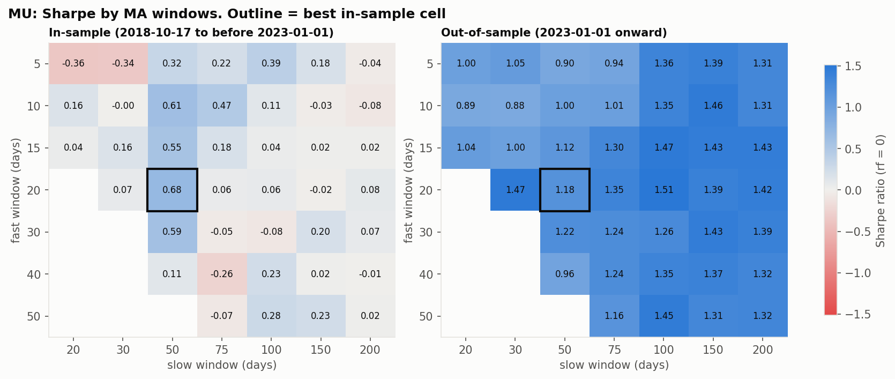
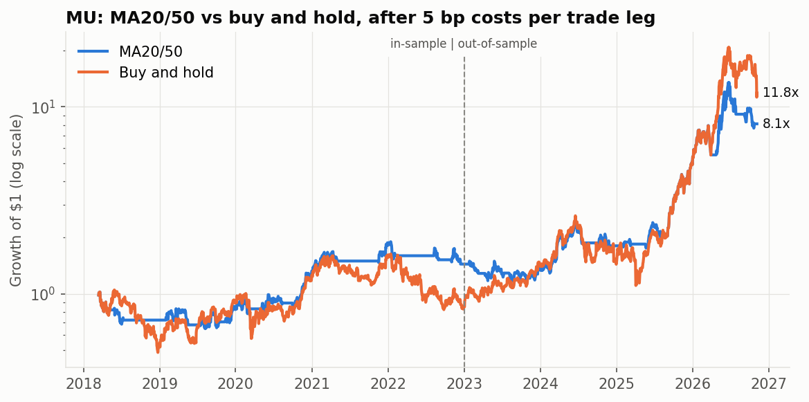
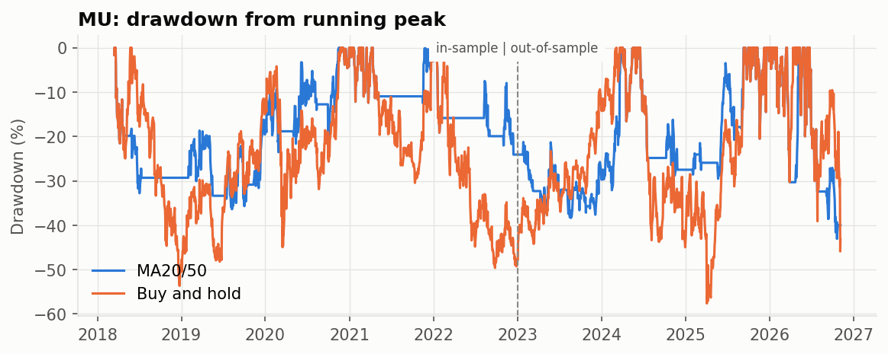

# Backtester

A small, vectorized research backtester in pandas. It answers two questions honestly:

1. **Does a moving-average crossover beat buy and hold** on a few semiconductor stocks and AAPL, once you separate in-sample from out-of-sample results and charge transaction costs?
2. **Can a random forest predict whether volatility will expand** over the next week better than simple baselines?

Short answers: **no**, and **not better than a one-line rule**. Most of the work went into making sure those answers are trustworthy: lookahead-safe timing, a purged walk-forward split, a test that fails if any feature uses future data, and an explicit in-sample/out-of-sample split.

This is a research project, not trading advice.

## Key findings

- **The MA20/50 crossover's Sharpe ratio was never distinguishable from buy and hold's.** Across 4 tickers and 2 periods, every gap was smaller than the ~0.5 standard error of a single Sharpe estimate. The strategy did cut maximum drawdown in all 8 cases (e.g. MU out-of-sample: 43% vs 58%). That is mostly because it is only invested 50–70% of the time.
- **Picking the best parameters in-sample didn't help out-of-sample.** The best in-sample cell of a 41-cell fast/slow grid ranked between 26th and 36th of 41 out-of-sample on every ticker. The rank correlation between in-sample and out-of-sample cell Sharpes was negative for all four tickers (−0.11 to −0.59).
- **The random forest beats the majority-class baseline by 5–9 points, but loses to a one-line rule.** The rule is "predict expansion when trailing volatility is below its training median", and it beat the forest in 4 of 5 folds on every ticker. Permutation importance confirms why: only `Volatility_10d` carries out-of-sample signal.

## Quick start

```bash
python3 -m venv venv
source venv/bin/activate
pip install -r requirements.txt

python -m backtester --ticker AAPL --fast 20 --slow 50 --start 2018-01-01
python -m pytest                    # 28 tests, offline, about 2 seconds
```

Reproduce every number in this README (prices to 2026-11-06):

```bash
python -m backtester --ticker MU AVGO MRVL --start 2018-01-01 --end 2026-11-07 --ml
python -m backtester --ticker AAPL --start 2018-01-01 --end 2026-11-07
```

Useful options are `--split-date` (default `2023-01-01`), `--cost-bps` (default 5), `--rf` (default 0), `--no-grid`, `--no-plots`, `--refresh` and `--help`. Prices are cached in `data_cache/`, so reruns don't hit Yahoo Finance. Charts go to `results/`.

## Method

**Data.** Daily prices from Yahoo Finance via `yfinance`, adjusted for splits and dividends (`auto_adjust=True`). Everything runs from 2018-01-01 to 2026-11-06.

**Timing.** `signal[t]` uses closes up to day t. The position held over day t+1 is `signal[t]`, i.e. `position = signal.shift(1)`, so no trade uses a price it couldn't have seen. The moving-average warm-up is dropped, and buy and hold is measured over exactly the same days as the strategy.

**Costs.** Each unit of position change pays `cost_bps` of portfolio value. This covers commission, half the spread and slippage in one number. Buy and hold pays one entry cost.

**In-sample / out-of-sample.**
- In-sample (IS): 2018-03-15 to 2022-12-30, 1,209 days.
- Out-of-sample (OOS): 2023-01-03 to 2026-11-06, 966 days.

Signals are computed on the full history. That is safe because they only look backward, and it means OOS starts with a valid position. The MA20/50 windows were fixed in advance, but the tickers were picked by a person in 2026 (see Limitations). So treat every IS number as description, and even OOS numbers as weak evidence.

**Metrics** (`backtester/metrics.py`, each with hand-computed tests):
- total return and CAGR
- annualized volatility (σ·√252)
- Sharpe ratio: mean / std of daily excess returns × √252, with **rf = 0** unless `--rf` is given (a slightly flattering choice)
- max drawdown with peak and trough dates
- win rate per round trip
- number of round trips
- exposure: the share of days invested

**ML.**
- Target: 1 if the standard deviation of the next 5 daily returns exceeds the trailing 10-day standard deviation.
- Features: 10 price and volume indicators.
- Validation: 5-fold expanding-window walk-forward. Before each test fold, 5 training rows are **purged**, because their labels were computed from prices inside the test fold.
- Baselines: the test fold's majority class (a deliberately tough upper bound on any constant guess), and a one-line volatility rule.
- `tests/test_ml.py` recomputes every feature with all data after date t deleted and fails if any value at t changes. A planted `shift(-1)` feature makes it fail, which shows the test isn't passing vacuously.

## Results

All results use MA20/50 with 5 bp per trade leg and rf = 0.

### Strategy vs buy and hold

| Ticker | Period | Strategy CAGR | B&H CAGR | Strategy Sharpe | B&H Sharpe | Strategy max DD | B&H max DD | Exposure |
|---|---|---:|---:|---:|---:|---:|---:|---:|
| MU   | IS  |  7.9% | −3.5% | 0.40 | 0.17 | 36.4% | 53.7% | 50% |
| MU   | OOS | 56.9% | 99.1% | 1.18 | 1.44 | 43.1% | 57.6% | 70% |
| AVGO | IS  | 12.9% | 21.9% | 0.61 | 0.72 | 31.3% | 48.3% | 66% |
| AVGO | OOS | 29.8% | 56.2% | 0.91 | 1.18 | 34.0% | 41.1% | 68% |
| MRVL | IS  |  0.1% | 10.9% | 0.16 | 0.45 | 54.5% | 61.2% | 57% |
| MRVL | OOS | 48.0% | 42.3% | 0.99 | 0.86 | 45.7% | 60.8% | 62% |
| AAPL | IS  | 19.0% | 26.2% | 0.87 | 0.86 | 25.1% | 38.5% | 65% |
| AAPL | OOS | 12.6% | 29.4% | 0.74 | 1.13 | 24.8% | 33.4% | 64% |

How to read this: a Sharpe estimated from about 4–5 years of data has a standard error of roughly 0.5. None of the strategy-vs-B&H Sharpe gaps above (the largest is 0.39) are large enough to call a difference.

### Transaction costs (MU)

| Cost per leg | IS CAGR | IS Sharpe | OOS CAGR | OOS Sharpe |
|---:|---:|---:|---:|---:|
| 0 bp  | 8.1% | 0.41 | 57.4% | 1.19 |
| 5 bp  | 7.9% | 0.40 | 56.9% | 1.18 |
| 20 bp | 7.2% | 0.38 | 55.6% | 1.16 |

The strategy trades only about 5 legs a year on every ticker (5.1–5.9). So even 20 bp per leg costs only about 1 percentage point a year. Costs are not why it trails buy and hold. Being in cash during rallies is.

### Parameter robustness: is the best cell real?

The grid covers fast ∈ {5, 10, 15, 20, 30, 40, 50} and slow ∈ {20, 30, 50, 75, 100, 150, 200}, with fast < slow, giving 41 cells. Every cell is scored over the same in-sample window, which starts after the 200-day warm-up.

| Ticker | Best IS cell | IS Sharpe | Same cell OOS Sharpe | OOS rank (of 41) | IS vs OOS rank correlation |
|---|---|---:|---:|---:|---:|
| MU   | 20/50  | 0.68 | 1.18 | 28 | −0.11 |
| AVGO | 50/100 | 0.97 | 0.91 | 26 | −0.29 |
| MRVL | 15/150 | 0.96 | 0.27 | 36 | −0.59 |
| AAPL | 5/30   | 1.48 | 0.67 | 30 | −0.32 |



**Why picking the best cell is overfitting.** Each cell's Sharpe is a noisy estimate, with a standard error of about 0.5 here. Taking the maximum of 41 noisy estimates selects the cell with the luckiest noise, so its in-sample Sharpe is biased upward even though nothing was "fitted" in the usual sense. The more cells you try, the bigger the bias. The data shows this directly: the in-sample winner landed in the bottom half out-of-sample every time, and the in-sample ranking was *anti*-correlated with the out-of-sample one. A robust result would look like a broad plateau of good cells that survives out-of-sample, not a single bright cell.

On MU, the best in-sample cell happened to be 20/50, the parameters chosen before any data was seen. That is a coincidence, not a validation: the same cell ranks 28th of 41 out-of-sample.

### ML: volatility expansion (out-of-sample, walk-forward, mean over 5 folds)

| Ticker | Forest accuracy | Majority baseline | Vol rule | Forest beat rule | Precision | Recall |
|---|---:|---:|---:|---:|---:|---:|
| MU   | 59.2% | 53.7% | 61.7% | 1/5 folds | 0.59 | 0.45 |
| AVGO | 63.0% | 56.8% | 66.1% | 1/5 folds | 0.62 | 0.43 |
| MRVL | 62.9% | 54.2% | 64.9% | 1/5 folds | 0.66 | 0.41 |

Confusion matrices, summed over folds (rows = actual, columns = predicted):

| Ticker | True neg | False pos | False neg | True pos |
|---|---:|---:|---:|---:|
| MU   | 691 | 278 | 459 | 377 |
| AVGO | 798 | 228 | 440 | 339 |
| MRVL | 794 | 185 | 485 | 341 |

Permutation importance on test folds: `Volatility_10d` drops accuracy by 6–8 points when shuffled, on every ticker. No other feature exceeds 2 points, and most are ≈0 or negative. The forest has essentially relearned "low volatility tends to rise". Per-fold tables and impurity importances are printed by `--ml`.

### Charts (MU)





Charts for AVGO, MRVL and AAPL are in [`results/`](results/).

## Surprising results, and why

1. **Most MU cells look *better* out-of-sample than in-sample.** The median cell Sharpe is 0.07 IS and 1.31 OOS. That isn't the strategy improving. 2023–2026 was a huge MU rally (buy and hold Sharpe 1.44), and any mostly-long rule rides it. Even so, the median cell still trails buy and hold OOS.
2. **The in-sample ranking was anti-informative.** Negative rank correlation on all four tickers means that, in this sample, choosing the "best" parameters was no better than choosing at random. With 41 overlapping cells these correlations are themselves noisy, so the safe reading is "no information", not "reliably reversed".
3. **The forest's recall collapses in the latest fold** (MU 0.19, MRVL 0.28 in 2025–26). It predicts "no expansion" far more often in the recent high-volatility regime. The precision still looks fine, which is why accuracy alone hid it.
4. **Costs barely matter here.** Slow crossovers trade rarely, so the realistic risk is not costs but regime dependence.

## Limitations

- **Selection and survivorship bias.** MU, AVGO, MRVL and AAPL were chosen in 2026, knowing they survived and that chips boomed. Stocks that were delisted or collapsed aren't in the sample. Any long-biased rule looks better on winners.
- **Few assets and one regime.** Four large-cap US tech names, highly correlated with each other, over one 8-year period. The OOS window is a single bull market for semiconductors.
- **Statistical power.** About 5 years IS and 4 years OOS give Sharpe standard errors near 0.5. The tests here can only detect large differences.
- **Cost model.** A flat bp cost per leg with fills at the close. No spread modelling, market impact, borrow costs or execution delay. Cash earns 0%, not T-bill rates, and Sharpe uses rf = 0.
- **Data.** Yahoo Finance adjusted closes. No point-in-time corrections, and adjustments can be revised.
- **ML target.** Comparing a 5-day sample standard deviation with a 10-day one is partly mechanical (volatility mean-reverts, and the two windows have different estimator bias). That makes the target easier than "predict volatility" sounds, which is exactly why the one-line rule is the right baseline.

## Project structure

```
backtester/
  data.py         Yahoo Finance download + CSV cache
  strategies.py   ma_crossover -> signal
  backtest.py     signal -> positions, costs, returns, equity; IS/OOS split
  metrics.py      return, vol, Sharpe, drawdown, win rate, trades, exposure
  robustness.py   fast x slow Sharpe grid, IS vs OOS
  ml.py           features, target, purged walk-forward, importances
  plots.py        charts saved to results/
  __main__.py     CLI
tests/            pytest: hand-computed metrics, timing, costs, purge, leakage
results/          charts embedded above
```
